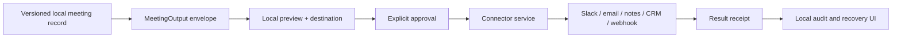

# Connector architecture

This is the clean-room contract for future meeting connectors. It is a design constraint, not evidence that
any connector ships. `PRODUCT_RELEASE_MATRIX.md` remains the production authority. Connectors must appear as
ordinary meeting/export features; they do not enable or promote the disabled Agents surface.

## Boundary

The desktop owns capture, correction, the canonical local meeting record, preview, approval UX, and the
local audit view. A separately deployed connector service owns OAuth callbacks, refresh tokens, provider
SDKs, rate limits, retries, and third-party execution. No connector runtime, browser automation process, or
provider SDK remains resident in the desktop app.



Core capture and transcription never depend on a connector being online. A connector outage cannot delay
meeting finalization, corrupt the local record, or silently drop an approved action.

## Meeting output envelope

Connectors consume an immutable, versioned projection instead of the desktop's storage layout:

```json
{
  "schemaVersion": 1,
  "eventId": "evt_...",
  "eventType": "meeting.finalized",
  "occurredAt": "RFC3339 timestamp",
  "meeting": {
    "id": "stable local ID",
    "revision": 7,
    "title": "resolved title",
    "startedAt": "RFC3339 timestamp",
    "endedAt": "RFC3339 timestamp",
    "participants": [],
    "transcript": {"revision": 5, "turns": []},
    "chat": {"revision": 2, "messages": []},
    "scratchpad": {"revision": 3, "text": ""},
    "derived": {
      "sourceRevision": 7,
      "summary": "",
      "decisions": [],
      "actionItems": [],
      "followUpDraft": ""
    }
  }
}
```

The canonical schema work in roadmap item M-03 is authoritative; this envelope must not freeze today's
private meeting JSON. Every derived block carries its source revision. Corrections produce a new envelope
and make older previews stale rather than mutating an already approved payload.

## Connector action envelope

Every proposed write has one explicit destination and one bounded operation:

```json
{
  "schemaVersion": 1,
  "actionId": "act_...",
  "connectorKey": "slack",
  "connectionId": "conn_...",
  "operation": "draft_message",
  "destination": {
    "type": "channel",
    "id": "provider-stable ID",
    "displayName": "#project"
  },
  "source": {
    "meetingId": "stable local ID",
    "meetingRevision": 7,
    "eventId": "evt_..."
  },
  "payload": {},
  "idempotencyKey": "stable for this exact action and source revision",
  "approval": {
    "state": "approved",
    "approvedAt": "RFC3339 timestamp"
  }
}
```

Provider tokens never appear in meeting outputs, action payloads, logs, receipts, or the WebView. Operations
are allowlisted per connector. Arbitrary provider method names, model-generated URLs, or model-selected
connections fail closed. “Send” is distinct from “draft”; a draft approval never authorizes sending.

## Receipt

Every execution returns a durable receipt, including failures:

```json
{
  "schemaVersion": 1,
  "receiptId": "rcpt_...",
  "actionId": "act_...",
  "idempotencyKey": "...",
  "status": "succeeded",
  "connectorKey": "slack",
  "connectionId": "conn_...",
  "destination": {"type": "channel", "id": "...", "displayName": "#project"},
  "providerReference": {"type": "message", "id": "..."},
  "attempt": 1,
  "completedAt": "RFC3339 timestamp",
  "retryable": false,
  "recovery": {"kind": "delete_or_manual", "available": true}
}
```

Receipts are safe to retain locally and contain no credentials or full provider response. Retrying the same
idempotency key must return the existing result or resume the same action, never create a duplicate.
Undo/delete is offered only where the provider contract can verify it; otherwise the UI gives an exact
manual recovery path.

## Execution rules

1. The desktop creates a preview from a named meeting revision and destination.
2. The user sees the exact payload/diff, connection, destination, and data that will leave the Mac.
3. Approval is scoped to that exact preview. Any source, payload, connection, or destination change
   invalidates it.
4. The connector service revalidates the operation allowlist, connection ownership, tenant policy,
   destination, payload bounds, and idempotency key.
5. Execution produces a receipt for success, retryable failure, permanent failure, or unknown outcome.
6. Unknown outcome is never presented as success. Reconciliation uses the idempotency key/provider reference
   before another write is attempted.

MCP is an adapter behind the same envelope, not a bypass. A custom MCP server needs an explicit server
identity, tool allowlist, argument schema, connection policy, and receipt. Admin policy may disable custom
servers or individual tools.

## Rollout

The first useful path is deliberately narrow:

1. local copy/export and follow-up email draft;
2. Slack draft and signed outbound webhook;
3. Notion page/database write with a field preview;
4. CRM note/task writes for HubSpot, Salesforce, and Attio after identity/field mapping is reliable; and
5. custom MCP servers and a long-tail workflow engine only after the same approval, idempotency, receipt,
   secret, tenant-isolation, and recovery suite passes.

Search/read can arrive before writes where it improves meeting prep, but connector data must carry provider
provenance and retention controls. Broad connector count is not a success metric; reliable completion of
the few recurring post-meeting jobs is.
