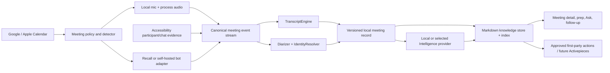

# Implementation roadmap

This is the actionable product and engineering plan. It describes intended work, dependencies, ownership
boundaries, and completion criteria; it is not evidence that a capability shipped. Production visibility is
authorized only by [`PRODUCT_RELEASE_MATRIX.md`](../PRODUCT_RELEASE_MATRIX.md), and current structural risks
live in [`ENGINEERING_HEALTH.md`](ENGINEERING_HEALTH.md).

## Product outcome

My Assistant wins by making a few recurring jobs disappear:

1. speak naturally and get correct text in the intended app;
2. join a meeting and receive a trustworthy record without setup or a visible bot;
3. let an optional bot attend when the computer or user cannot;
4. turn transcript + meeting chat + scratchpad into useful notes, identities, commitments, and follow-up; and
5. later, use that inspectable knowledge to draft or carry out approved work.

Dictation quality is non-negotiable. Meetings remains Beta until its real-call matrix, speaker identity,
recovery, and local Intelligence lifecycle are credible. Agents remains one disabled **Coming soon** label in
production while the knowledge foundation is built underneath ordinary meeting and preparation workflows.

## Customer experience

### First-run setup

The user makes a small number of durable choices once:

- select a qualified local speech model with plain-language quality, language, memory, and disk guidance;
- choose the Dictation shortcut and run a real insertion check;
- enable Meetings Beta and grant System Audio only when first used;
- optionally connect Google Calendar and/or Apple Calendar;
- choose the default meeting policy: **Do not record**, **Ask when detected**, or **Record automatically**;
- separately choose an off-PC policy: **Never send a bot**, **Ask per scheduled meeting**, or **Join for me**;
- choose local meeting Intelligence, BYOK, or no generated notes; and
- see exact retention and cloud-transfer copy before enabling any remote provider.

After this, the product should be forgettable until it is useful. Permission, model, provider, or calendar
failures appear as one actionable recovery, not a settings scavenger hunt.

### Dictation

The current global shortcut and native pill remain the primary interaction. The premium contextual path is a
natural extension, not a new Agent product:

1. the user focuses an email/message/text field and invokes **Reply with voice**;
2. a bounded context reader uses Accessibility semantics first and OCR only for the visible, explicitly
   approved region when semantics are unavailable;
3. the user dictates intent rather than exact prose;
4. the app drafts a reply grounded only in the approved context and the user's spoken instruction;
5. it previews the exact text when confidence or target safety is low, otherwise inserts into the still-owned
   field; and
6. it never sends, clicks, or submits.

No continuous screen recording is needed. Context is ephemeral by default, secure fields are excluded, and
the same target-drift/clipboard fail-closed rules as Dictation apply.

### Meeting detection outside the main window

Meeting detection is an OS-level event, not an “app is open” screen and not solely a speech detector.
Authoritative local evidence combines active meeting/process audio with supported meeting-window semantics;
calendar context enriches the title and expected participants but never starts recording by itself.

On the call edge, a movable 52 × 52 non-activating native Nub plus notification appears on the active
display. Clicking it expands to an adaptive vertical conversation card: meeting and local-capture state,
up to five speaker-grouped transcript bubbles, last-minute catch-up, then proportionate recording controls.
The Mac Beta currently auto-starts when enabled and uses the shared lifecycle:

```text
Starting Google Meet capture…      [Open] [Stop]
Checking microphone + meeting audio

Recording Google Meet locally      [Pause] [Stop]
Microphone + meeting audio confirmed
```

The recording label is unavailable until both native audio sources open successfully. Speech is not a
readiness prerequisite, so a locally speaking user is captured even when the remote side remains silent.
After system audio has flowed, loss of its buffer heartbeat tears down and retries that source. A missing
permission or failed source changes the same panel to **Needs attention**. Three failed recoveries in one
minute recycle the supervised helper process and the signed parent relaunches it with bounded backoff while
the Rust meeting identity remains open. Pause releases both sources; Resume returns through Starting; and
call end remains visible as Finalizing. The main app does not steal focus. The future **Ask / Not this
time** policy remains separate work and must reuse this lifecycle rather than fork it.

### During the meeting

The optional compact panel has four quiet surfaces:

- **Transcript:** genuinely live text, automatic speaker names where evidence supports them, and an honest
  temporary label otherwise;
- **Chat:** captured platform chat with author and timestamp where a supported adapter exposes it;
- **Notes:** the user's scratchpad, always local and never overwritten; and
- **Status:** capture source, elapsed time, privacy mode, Pause, Resume, and Stop.

Corrections remain available as recovery, but the success metric is that ordinary users never need them.
Internally every word/turn/name carries provenance and confidence; the normal UI stays clean.

### After the meeting

One canonical source record contains:

```text
meeting metadata + participants + calendar identities
  + timestamped transcript and speaker turns
  + meeting chat
  + the user's scratchpad
  + optional recording references
```

Processing produces title, summary, decisions, action items, unanswered questions, follow-up draft, and
linked people/project/commitment notes. Every derived block points to its source revision and becomes stale
when a correction changes that source. Ask uses the corrected record and cites transcript/chat/note moments
inside the meeting view.

The meeting detail should feel closer to Fathom's usefulness and Rowboat's inspectable memory than to a raw
transcription utility: the answer is prominent, the evidence is one click away, and the underlying Markdown
knowledge remains editable and portable.

### When the Mac is off

A scheduled server-side bot can join only after the user explicitly enables that policy. Calendar event
controls allow **No bot**, **Ask**, or **Join for me** per event and remember an optional series preference.
The bot has a clear display name, joins/leaves automatically, obeys consent/organization policy, and streams
artifacts into the same meeting pipeline. Local and bot capture are deduplicated by event + meeting URL +
time, and the source remains visible in meeting privacy details.

## Canonical architecture



The canonical event stream prevents a managed bot, a self-hosted bot, and local capture from creating three
products. Each adapter normalizes into the same meeting, participant, chat, audio, transcript, and lifecycle
schemas. The desktop app is still useful offline; server features are additive.

## Quality rules for speakers and identity

“Speaker 1” is a recovery state, not the product target. Naming uses multiple independent signals:

1. the mic channel is the signed-in user;
2. meeting Accessibility data provides participant names and active-speaker evidence when supported;
3. diarization clusters remote audio and tracks repeated voices, including overlap where the selected model
   supports it;
4. calendar attendees provide expected names and authorized email addresses;
5. bot providers may provide platform participant IDs, names, timelines, and—in calendar-backed modes—email;
6. an evidence merger assigns a name only above a calibrated threshold and keeps its sources; and
7. one user correction updates the durable identity mapping and invalidates affected derived notes.

Display names never fabricate email addresses. Emails come only from an authorized calendar/provider source.
Identity data is local by default, deletable, scoped to the user/workspace, and excluded from logs.

## Packaging and tiers hypothesis

Tiers are product hypotheses until billing and entitlement are deliberately shipped.

| Capability | Free / local core | Paid value candidate |
|---|---|---|
| Dictation | Qualified local transcription, safe insertion, essential settings | Context-aware voice replies, higher-end managed models, organization vocabulary/policies |
| Meetings | Bot-free local capture, transcript, scratchpad, basic notes with local/BYOK compute | Managed off-PC bot hours, advanced meeting Intelligence, cross-device access/sync, team controls |
| Knowledge | Local meeting library and portable Markdown export | Compounding knowledge graph, proactive meeting prep, cross-meeting synthesis, managed encrypted sync |
| Workflows | First-party export/follow-up actions | Curated integration packs and later custom workflow builder |

Do not cripple the local core to manufacture a plan. Paid value should remove compute, coordination, and
automation burdens that have real ongoing cost.

## Delivery program

Effort below is senior-engineering-equivalent person-weeks. Calendar estimates assume one integration owner
and up to three additional controlled Codex/Claude worktree sessions. AI parallelism reduces implementation
latency; it does not parallelize architecture decisions, real-device testing, provider approvals, or final
integration.

### Wave 0 — restore a parallel-safe foundation

**Effort:** 2–3 person-weeks; approximately 1–2 calendar weeks.

| ID | Work | Dependency | Done when |
|---|---|---|---|
| H-01 | Split `local_server.rs` into auth/router, settings/secrets, speech models, meetings, Intelligence, and dormant Agent modules | None | Route contract unchanged; each module has focused tests; no new process or copy of shared state |
| H-02 | Finish splitting `lib.rs` into app lifecycle, dictation orchestration, shortcut/target, meeting helpers, and platform adapters; keep the extracted `meeting_detection.rs` policy OS-free | H-01 interface agreement | Existing Rust tests and native build pass; platform-specific imports are target-gated; no reusable policy moves back into Swift |
| H-03 | Split `index.html` into build-time source modules while still shipping one minified local asset | Stable selectors/release registry | Visual/production contract unchanged; no runtime framework or extra process; UI owners stop editing one file |
| H-04 | Isolate dormant Agent research from the default production compile | H-01/H-03 | Default binary has no Agent route/ACL/boot/compute code; disabled label remains; research can still be built explicitly or is preserved in its branch |
| H-05 | Establish version/release metadata source and component manifest/SBOM generation | None | Cargo/Tauri/artifact/release-note labels cannot disagree; named artifacts require explicit release evidence |
| H-06 | Freeze reproducible installed-size, RSS/CPU/wakeup, latency, model-memory, and disk-growth baselines | Stable current candidate | Baseline script produces aggregate, privacy-safe output and a regression comparison |
| H-07 | Introduce target-gated `AudioSource`, `MeetingEvidenceSource`, target, overlay, and permission contracts; freeze platform-neutral observation fixtures | H-02/M-01 interface agreement | macOS behavior stays green; Apple types cannot enter product policy or schemas; [`WINDOWS_HANDOFF.md`](WINDOWS_HANDOFF.md) gives a Windows owner an executable X-00 packet without claiming Windows validation from this Mac |

### Wave 1 — Dictation release quality

**Effort:** 3–5 person-weeks; approximately 2–4 calendar weeks, gated by physical testing.

| ID | Work | Dependency | Done when |
|---|---|---|---|
| D-01 | Complete exact-DMG physical shortcut, permission, display/Space, sleep/wake, rapid-use, target-app, and clipboard matrices | H-05 | All supported cases pass or the support claim narrows visibly |
| D-02 | Qualify every streaming-capable catalog model with real microphone input and target reconciliation | H-06 | First-text/final quality, stable prefix, target drift, and fallback meet frozen gates |
| D-03 | Ship privacy-safe diagnostic export | H-02 | Support bundle contains versions, permissions, model IDs, timings, and codes; never user text/audio/identity/secrets |
| D-04 | Prototype **Reply with voice** using bounded Accessibility context and no OCR | H-02 | Gmail/webmail/message fixtures produce useful drafts, never send, and fail closed on target/context drift |
| D-05 | Add OCR fallback only for explicitly approved visible context gaps | D-04 | Accessibility remains primary; capture scope/retention is visible; OCR improves task success without unacceptable CPU/RAM/privacy cost |

The first three items are release blockers. Contextual dictation is a later premium candidate and must not
delay ordinary dictation reliability.

### Wave 2 — Meetings Beta core quality

**Effort:** 8–12 person-weeks; approximately 5–8 calendar weeks with controlled overlap.

| ID | Work | Dependency | Done when |
|---|---|---|---|
| M-01 | Introduce `AudioSource` and qualify FlexAudio against the existing CPAL/Core Audio implementation on macOS | H-02/H-06 | Same or better audio quality, detection, device hot-swap, long-call stability, CPU/RSS, and TCC behavior; otherwise retain the existing adapter. Windows proof belongs to X-00/X-02 |
| M-02 | Finish the shared Rust `MeetingDetector` evidence/policy state machine above the shipped two-hit start, three-miss end, source-family controls, and rising-edge notification suppression | H-02/H-07 | Silence does not prevent call-edge detection; media playback does not start a call; auto/ask/ignore/manual and per-app exclusion policies have deterministic cross-platform fixtures |
| M-03 | Define canonical meeting event and record schemas with migrations | H-01 | Local and future bot events normalize identically; old meeting JSON migrates losslessly; revisions/provenance are explicit |
| M-04 | Capture supported meeting chat via bounded platform adapters | M-03 | Author/text/time/source persist with transcript + scratchpad; unsupported apps say unavailable, not empty-success |
| M-05 | Benchmark `speakrs` and `pyannote-rs`; adopt one local diarizer | M-01/M-03 | Representative DER/overlap, live latency, post-call correction, RSS/CPU, and model lifecycle select one macOS winner; X-03 separately proves or replaces its Windows backend |
| M-06 | Implement `IdentityResolver` across self channel, Accessibility, diarization, and corrections | M-05 | Automatic names meet calibrated accuracy; uncertain names remain honest; one correction updates future mapping safely |
| M-07 | Add Google Calendar and EventKit adapters | M-03 | OAuth/revoke/sync/dedup/recurrence/offline cache work; event never triggers capture without call evidence; attendee emails retain provenance |
| M-08 | Add bounded in-flight audio checkpoints and recovery | M-01/M-03 | A forced kill loses at most the defined window; private checkpoints recover once and clean up; no orphan audio remains |
| M-09 | Complete real two-person Zoom/Meet/Teams/FaceTime/Slack and device-change matrix | M-02/M-04/M-06/M-08 | Detection, transcript, speaker names, chat where supported, pause/resume/end, recovery, and resource gates pass on exact installed candidate |
| M-10 | Qualify open-source WebRTC AudioProcessing AEC3 behind `AudioSource` | M-01/H-06 | Speaker playback is removed from the mic channel without damaging near-end speech; headset bypass, delay, double-talk, hot-plug, long-call, CPU/RSS, licensing, and macOS gates pass. X-03 owns Windows qualification |

### Mac Meetings Beta release cuts

The complete Wave 2 matrix remains the graduation target, but it should not obscure the shortest honest path
to real use:

| Cut | Scope | Gate | Planning range |
|---|---|---|---|
| Installed dogfood candidate | Current signed local build: manual/automatic capture, live transcript, pause/resume/stop, scratchpad, library, corrections, summary/Ask, and grounded Live Assist | Use only with explicit Beta expectations; no platform is claimed proven from automated tests | Available now |
| Narrow private Beta | Zoom native and Google Meet in Chrome; manual fallback elsewhere; headset path first, speaker path only if echo/duplication passes | Two consenting people on the exact installed candidate; complete [`MEETINGS_USER_JOURNEY.md`](MEETINGS_USER_JOURNEY.md) outside-app signals; both audio channels; one start/end; pause/relaunch; notes/Live Assist with configured provider; 45-minute soak; failures fixed and rerun | First evidence in 1–2 days; credible cut in 3–7 working days if no deep capture defect |
| Reliable Mac Beta | Narrow cut plus bounded in-flight audio recovery, privacy-safe diagnostics, speaker-device baseline/AEC decision, and repeated clean-install/permission tests | No known data-loss path inside the declared recovery window; supported-device and provider limitations are visible | Approximately 2–3 calendar weeks |
| Broad Mac Meetings Beta | Full M-02 through M-10 acceptance across the advertised platform/device matrix, chat, diarization/identity, calendar truth, recovery, and speaker playback | Complete [`ACCEPTANCE_TESTS.md`](ACCEPTANCE_TESTS.md) two-person matrix against the exact candidate | Approximately 5–8 calendar weeks |

These ranges assume daily access to a second consenting caller. They are gates, not promises: a Core Audio,
permission, device-change, or model-quality defect can extend them. Chat, calendar, automatic speaker names,
off-PC bots, connectors, Windows, and the future Agent surface do not block the narrow private Beta. The UI
must say unavailable or use an honest unknown-speaker label until each later capability passes.

### Wave 3 — Meeting Intelligence and compounding memory

**Effort:** 6–10 person-weeks; approximately 4–7 calendar weeks, overlapping late Wave 2.

| ID | Work | Dependency | Done when |
|---|---|---|---|
| I-01 | Complete verified local meeting Intelligence install/status/remove/update/unload | H-05 | Clean Mac can use useful local notes without shell setup; executable/model integrity, port ownership/auth, RAM guidance, and recovery are enforced |
| I-02 | Build a corrected-source evaluation set for title, summary, decisions, owners, open questions, and Ask | M-03 | Local and cloud providers are compared on usefulness/faithfulness; hallucinated owners/decisions are release failures |
| I-03 | Qualify grounded Live Assist under active capture | I-01/I-02 | Last-minute catch-up uses the exact 60-second non-excluded window; summary/actions/questions pass faithfulness and latency gates; cancellation, provider failure, and repeated clicks never affect capture or duplicate work |
| K-01 | Add an Obsidian-compatible Markdown knowledge store with stable IDs, backlinks, provenance, and atomic writes | M-03 | People/projects/decisions/commitments remain human-readable, editable, portable, and rebuildable from source records |
| K-02 | Add a lightweight local index for exact/full-text retrieval; qualify embeddings only where they improve measured tasks | K-01 | Meeting prep/Ask finds cited source material quickly without loading a model while idle |
| K-03 | Ship meeting prep, follow-up draft, and cross-meeting person/project pages as ordinary meeting features | K-01/K-02/I-02 | Users receive useful context without an Agent mode; every mutation is reviewable and source-linked |

### Wave 4 — Off-PC and autonomous attendance

**Managed Recall effort:** 4–7 person-weeks; approximately 3–5 calendar weeks.

**Self-host Vexa qualification:** an additional 6–10 person-weeks plus ongoing operations.

| ID | Work | Dependency | Done when |
|---|---|---|---|
| B-01 | Define `BotMeetingProvider`, webhook replay/idempotency, retention, deletion, and local/bot dedupe | M-03/M-07 | Provider fixtures cannot create duplicates or cross-tenant data; failure states are recoverable and auditable |
| B-02 | Qualify Recall managed bots | B-01 | Supported-platform join/leave reliability, transcript/speaker/chat/participant artifacts, calendar scheduling, region/retention/cost, consent, and deletion pass |
| B-03 | Ship per-event/series **No bot / Ask / Join for me** policy | B-02 | PC-off meeting produces the same canonical record; user can cancel, revoke calendar, and delete data |
| B-04 | Deploy and benchmark pinned Vexa on production-like infrastructure | B-01 | Upgrade/rollback, secrets, storage, browsers/media capacity, observability, backups, and platform quality meet or beat the managed acceptance suite at justified total cost |
| B-05 | Keep Attendee as a same-contract control if license and dependency review passes | B-01 | It replaces Vexa only if evidence shows a material user/operations advantage |

Hostinger is an infrastructure candidate, not a decision. Browser/media bots need measured CPU, memory,
concurrency, networking, storage, and failure recovery; a cheap VM is acceptable only if the provider suite
passes under realistic concurrent calls.

### Wave 5 — Integrations and future Agent mode

**Effort:** 5–8 person-weeks for curated actions; custom builder timing follows demand. This wave cannot
promote Agents without a separate product/release decision.

| ID | Work | Dependency | Done when |
|---|---|---|---|
| W-00 | Implement the versioned meeting-output, approved-action, and receipt envelopes in [`CONNECTOR_ARCHITECTURE.md`](CONNECTOR_ARCHITECTURE.md) | M-03/K-03 | Contract fixtures reject stale revisions, changed destinations, secrets, duplicate execution, unknown outcomes, and unapproved writes |
| W-01 | Ship first-party approved actions: copy/export, follow-up email draft, Slack draft, signed webhook, and task draft | W-00 | Preview, exact diff, explicit destination, confirmation, idempotency, receipt, and undo/recovery where possible |
| W-02 | Evaluate Activepieces core as a separate multi-tenant workflow service | W-01 | License/embedding boundary, secrets, upgrades, rollback, tenant isolation, retries, and audit pass with no desktop idle cost |
| W-03 | Add Notion and CRM note/task connectors, then curated workflow templates | W-01/W-02 | Field mapping is previewed; high-frequency workflows complete reliably and expose understandable failures; core meeting success never depends on them |
| W-04 | Add controlled custom MCP servers only behind the same action envelope | W-00/W-03 | Server/tool allowlists, argument schemas, admin policy, tenant isolation, receipts, and recovery pass; MCP cannot bypass approvals |
| A-01 | Write the separate Agent brief using Rowboat-inspired Markdown memory and deterministic permissions | K-03/W-01 | Scope answers what jobs Agents uniquely solve beyond ChatGPT/Claude, what they may read/change, approval/undo, compute, pricing, and physical acceptance |
| A-02 | Build an Agent mode only after A-01 is approved | A-01 | Release matrix is deliberately updated; no hidden mutation, prompt-only authorization, or unbounded computer control |

### Wave 6 — Windows

**Effort:** 12–20 person-weeks; approximately 8–14 calendar weeks after platform seams and shared quality
metrics are stable.

| ID | Work | Dependency | Done when |
|---|---|---|---|
| X-00 | Execute the [`WINDOWS_HANDOFF.md`](WINDOWS_HANDOFF.md) bootstrap on a native Windows host: target-gate Apple dependencies, add fail-closed capability stubs, and compile/test the shared core | H-07 | Native Windows or Windows CI—not a Mac cross-compile—builds OS-free policy/routes and reports unsupported adapters honestly |
| X-01 | Promote the X-00 skeleton into a supported application target; finish target-specific dependencies, packaging, and platform capability reporting | X-00/M-01 | Windows builds the same product core and reports unsupported adapter capabilities honestly |
| X-02 | Implement Windows shortcut, overlay, target insertion/context, permissions, mic/system/process audio, and meeting evidence adapters | X-01 | Windows privacy and fail-closed semantics equal macOS, using WASAPI/UI Automation/native APIs; physical Zoom/Meet capture passes |
| X-03 | Qualify speech/diarization backends and model packaging on representative Windows hardware | X-01/M-05 | Quality, latency, memory, GPU/CPU fallback, download, and recovery meet published device tiers |
| X-04 | Complete Windows app/platform/permission/installer/update physical matrices | X-02/X-03 | No macOS-only claim leaks into Windows; exact installer passes clean-machine and long-use tests |

## Realistic delivery expectation

The current installed app can begin dogfood calls now; the release-cut table above is the authority for the
narrow private and reliable Mac Beta ranges. With disciplined parallel sessions, completing a high-quality
Dictation release plus the broad local Meetings Beta program is roughly an **8–12 calendar-week** program
after the foundation split. Adding compounding knowledge and a managed off-PC bot makes the useful complete
product roughly **14–20 calendar weeks**. Self-host bot operations, custom workflow building, and Windows
extend the full ambition to approximately **six to nine months** for one senior integration owner using AI
sessions heavily. Provider approvals, physical matrices, and quality failures can lengthen the critical path.

These are planning ranges, not deadlines. Cutting the range means reducing scope—for example managed Recall
before self-hosting, curated actions before a builder, and local meeting quality before Windows—not lowering
quality gates.

## Parallel-session operating model

Parallel work starts after Wave 0 defines stable ownership seams. Use Git worktrees and `codex/` branches;
one session owns one bounded task and its tests. The integration owner alone changes shared schemas,
`Cargo.lock`, release capabilities, and final documentation unless a task packet explicitly delegates them.

### Initial four lanes

| Lane | Owns | Must not edit concurrently |
|---|---|---|
| Integration | schemas, traits, release registry, Cargo/toolchain, merges | Feature implementation assigned to another lane |
| Dictation | target/capture/cleanup/physical tooling | Meeting adapters or knowledge schema |
| Meetings | detector, audio, chat, diarization, identity | Dictation orchestration or workflow runtime |
| Knowledge/cloud | calendar, Intelligence, Markdown store, bot provider | Native capture internals |

### Task packet required for every session

```text
Outcome:
Owned files/modules:
Interfaces it may consume:
Interfaces it may change (normally none):
Product and privacy invariants:
Acceptance criteria:
Required tests and measurements:
Docs that become false if this lands:
Explicit non-goals:
```

Sessions return a narrow commit plus test evidence and unresolved risks. They do not merge themselves. Before
integration, rebase onto the current integration branch, inspect the complete diff, run affected contracts,
then run the full source gate. Installed-app, microphone/TCC, and DMG tests are serialized on the physical Mac;
multiple worktrees must never fight over `/Applications/My Assistant.app`, fixed ports, Keychain items, or
macOS permissions.

## Next actionable sequence

1. Land the current shared-detector/release-boundary work and retain a green installed-app baseline.
2. Run the narrow two-person Zoom-native and Google-Meet-Chrome headset matrix immediately. Fix and rerun the
   smallest observed capture/detection/lifecycle failures before adopting a new audio stack.
3. Freeze the H-06 baseline from that exact candidate and cut the narrow private Beta only when its 45-minute
   soak and provider/no-provider journeys are honest.
4. Implement M-03/M-08 canonical records and bounded audio recovery, plus D-03 diagnostics, to reach the
   reliable Mac Beta cut.
5. Execute H-01 through H-05 as behavior-preserving foundation work around those frozen contracts; do not mix
   new product behavior into the refactor commits.
6. Run M-01 FlexAudio and M-05 `speakrs` component spikes behind the stable seams; keep only measured winners.
7. Build M-02/M-04/M-06/M-07/M-10 and then pass the broad M-09 real-call acceptance.
8. Build I-01/K-01 first, because useful local Intelligence and inspectable Markdown memory improve Meetings
   without exposing Agents.
9. Add Recall through B-01/B-02/B-03; run Vexa as a measured deployment track, not an app dependency.
10. Ship curated first-party actions before Activepieces or an Agent surface.
11. Keep Windows inputs portable through target-gated contracts and shared fixtures. A Windows owner executes
    X-00 from [`WINDOWS_HANDOFF.md`](WINDOWS_HANDOFF.md); do not turn a Mac cross-compile into a Windows
    support claim. Begin physical adapters after the shared capture/schema/performance contracts are stable.
