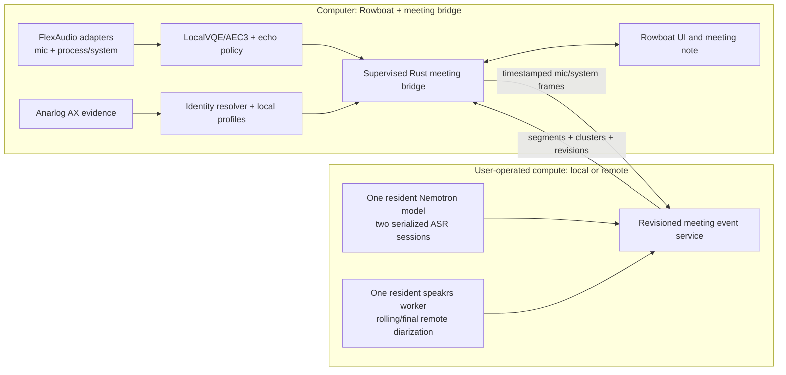

# Rowboat meetings: OSS assembly and implementation plan

## Outcome

Rowboat remains the product, note editor, live meeting view, and LLM interface. The meeting pipeline becomes a
small supervised Rust bridge on the computer plus a user-operated transcription service on local or remote
compute. It
must start both audio channels at the beginning of capture, survive silent participants and audio-device
changes, preserve overlapping speech, and show a person's name only when direct evidence supports it.

This plan deliberately does **not** add another meeting overlay, Nub, transcript window, or catch-up surface.
Rowboat already owns the meeting experience. It does not bundle another ASR or local LLM in this plan; the
same provider contract may target a loopback worker, a private-LAN/VPN worker, or an authenticated TLS
service. Local bridge work is limited to capture, AEC, evidence collection, bounded buffering, and transport.

Calendar is outside the speaker-identity and capture-readiness paths:

- no attendee-to-speaker matching;
- no calendar-derived names or identity guesses;
- no Calendar permission is required to capture or name a meeting; and
- Rowboat's existing optional calendar/preparation features may remain, but their output cannot enter the
  identity resolver or decide whether audio is healthy.

## Current baseline and the gap

The Rowboat branch `codex/self-hosted-meeting-stt` at `6b3ad292` already:

- captures microphone and system audio;
- opens two named sessions against the private Nemotron service;
- keeps one Nemotron model resident on the selected worker;
- reconnects a failed transcription transport; and
- renders a live transcript in the Rowboat meeting note.

The measured Hostinger KVM 1 reference has one vCPU, 4 GB RAM, 2 GB swap, one Q8 Nemotron 3.5 model, two
560 ms sessions, and globally serialized inference. Two real-time input streams were qualified with a maximum
scheduling lag of 288.6 ms and about 1.27 GB container memory. This supports simultaneous mic and playback
ingestion; it does not yet separate multiple voices inside the playback mix.

The current Rowboat renderer still has four correctness problems:

1. It assigns `You` to all mic-session text and `Remote participant` to all system-session text.
2. Its self-hosted snapshots are text-prefixes without authoritative audio intervals.
3. Its speaker-mode echo heuristic suppresses/gates mic audio while system audio is active, so double-talk can
   lose the local speaker.
4. It periodically rewrites the complete note instead of merging revisioned transcript records into one
   owned transcript block.

These are protocol/domain problems. Styling the existing labels cannot fix them.

## Decisions from the source audit

Audit snapshot:

| Project | Audited revision | License | Use |
|---|---|---|---|
| Rowboat | `6b3ad29296b737f7a2caf1de24b15bfe9f354b1b` | Apache-2.0 | Product UI, notes, meetings flow, LLM/provider integration |
| My Assistant | `f5f537fb9da2ed8e7d317dcb2b1d2ff8a6b4d040` plus the current self-host worktree | project-owned | Detector, attribution, recovery, self-hosting, and acceptance contracts |
| FlexAudio | `7e41bbd0b03c4f52260926fa0148ca0e0179fda1` | MIT | Preferred cross-platform capture engine, behind qualification |
| Anarlog | `609ee772801f29292e4edee453f269089ebf0e8b` | MIT | macOS Accessibility meeting, participant, and active-speaker evidence |
| Muesli | `fd0d4984d769408474cccdb3411d8365ffcbc672` | MIT | AEC time alignment, reference buffering, health, and repair policy |
| OpenWhispr | `36418be57e3794948150e5d4c590efcda40fda01` | MIT | AEC3 fallback, echo/double-talk classifier, holdback, and profile UX concepts |
| Minutes | `f1cf1df3be7e63225e70811347bf81c19b0069ee` | MIT | Immutable voice samples, trust/provenance, revocation, and conservative name correction |
| speakrs | `b0756b1f39e63f3cb4d49ceca68ba0265d603848` | Apache-2.0 | Self-hosted overlap-aware diarization and speaker embeddings |
| LocalVQE | qualify and pin during implementation | Apache-2.0 | Preferred lightweight cross-platform local AEC candidate |

Every direct dependency or vendored module gets a source URL, exact revision, license text, checksum where
applicable, local patch list, qualification suite, and rollback revision. Extracted proprietary applications
remain behavior references only; no Fathom, Granola, Fireflies, or Wispr private code or credentials enter the
repository.

### Take directly

#### FlexAudio capture facade and native backends

Use FlexAudio behind our `AudioSource` adapter because it already provides:

- mic, system, and per-process capture on macOS, Windows, and Linux;
- normalized 20 ms `f32` chunks at a selectable output format;
- monotonic sequence numbers, drop counts, RMS/peak, and discontinuity/recovered flags;
- a two-second stall detector, exponential-backoff reopen, hot source switching, and bounded rings;
- Core Audio Process Taps on macOS and WASAPI loopback/process capture on Windows; and
- Rust, C, Python, and Node bindings.

Do not promote it directly to production yet. The audit found:

- macOS Core Audio callback timestamps are ignored; `pts_ns` is currently based on intake arrival time;
- macOS and Windows `DeviceWatcher` currently degrade to a no-op (the implemented watcher is Linux-only);
- its recovery event is emitted when the backend reopens, before the adapter has proved a real post-reopen
  audio buffer; and
- the project is young (eight public commits at audit time), so its capability claims require our own
  physical matrix.

The integration therefore starts as an A/B adapter. Before it becomes the default, contribute or carry a
small patch that passes native hardware timestamps through `RawSink`, adds macOS/Windows device-change
events, and changes readiness to require the first valid post-reopen chunk. Keep the present Rowboat capture
path as one-change rollback until FlexAudio passes the matrix.

#### Anarlog meeting Accessibility module

Vendor the bounded `meeting_ax` module at the pinned revision, preserving its MIT notice and provenance, or
depend on a standalone upstream crate if one is split out before implementation. Do not rewrite its parsers.
It already provides:

- a bounded AX scan (`MAX_TREE_DEPTH=18`, `MAX_NODES=1800`, 0.6 s messaging timeout);
- native Zoom, Teams, Slack, Discord, and Webex classification;
- browser contexts for Meet, Teams, Zoom Web, Webex, Slack, and Discord;
- participant name, surface, bounds, confidence, signals, and active-speaker state;
- specific parsing for labels such as Zoom's `Video render <name>` and `<name> is speaking`;
- generic-name rejection, duplicate handling, self markers, and fail-closed ambiguity; and
- fixture coverage for browser/native differences and speaker-state labels.

Run it in the Rust bridge, never in the renderer. Poll at a low bounded cadence and emit only normalized
participant/active-speaker observations. Do not expose unrelated AX text or full trees to Rowboat or logs.

Anarlog's current Chrome native-host schema has Meet URL, active state, mute, participant names, and self
flags, but not an authoritative active-speaker transition. Its host is therefore a later browser transport,
not the Phase 1 source of speaker timing.

#### LocalVQE, with Muesli's alignment policy

Use LocalVQE as the first AEC candidate because it is causal, cross-platform, CPU-oriented, and needs only
mic plus far-end reference. Prefer evaluating the echo-only v1.4 200K model before Muesli's older v1.2 joint
AEC/noise/dereverb model: preserving the near-end voice matters more than applying extra denoise.

Port Muesli's MIT-licensed streaming mechanics into Rust rather than carrying its macOS/Swift application:

- serialize independent mic/system callbacks onto one audio queue;
- keep mic frames pending until their position-aligned system reference exists;
- retain bounded mic/system histories;
- preserve sample count across flush and partial frames;
- count full, partial, and missing reference frames;
- retain raw mic for health/repair evidence while VAD and ASR consume the cleaned mic; and
- pass through the original frame on model failure instead of losing speech.

The FlexAudio timestamp patch should become the primary alignment signal. Correlation-based delay estimation
is a diagnostic/fallback, not permission to shift a stream on weak evidence.

Keep OpenWhispr's process-isolated WebRTC AEC3 helper as the rollback candidate. A corpus gate, not
preference, chooses LocalVQE versus AEC3.

#### OpenWhispr echo, double-talk, and holdback policy

Port the small policy layer, not the Electron application:

- cross-correlate recent playback and mic history over a bounded lag;
- classify far-end leakage, clean local speech, and double-talk;
- never discard the mic merely because playback is active;
- allow an uncertain mic turn to wait briefly for supporting system/text evidence;
- discard only after a confirmed duplicate, not from energy alone; and
- permit a late system result to retract a confirmed duplicate with a transcript revision.

This replaces Rowboat's current `system audio active => suppress mic` behavior. During simultaneous speech,
both channels remain available to ASR.

#### speakrs diarization on the compute worker

Use speakrs rather than OpenWhispr's live clusterer or pyannote-rs. speakrs preserves separate local speaker
tracks and overlapping activity, performs the full segmentation/overlap-add/embedding/PLDA/VBx pipeline,
returns frame-level activation plus embeddings, and has a CPU mode without a Python runtime.

It is not a true stable incremental diarizer. Its public high-level API processes a supplied recording/window
and recording-wide clustering may revise prior labels. Integrate it as one long-lived worker with rolling
windows and revisioned output:

- receive only the mixed remote/system channel;
- process a 30-60 second rolling window at a measured cadence;
- overlap adjacent windows by at least the model context needed for stable turns;
- stitch clusters using time overlap plus returned centroid/embedding evidence;
- keep the newest horizon provisional;
- commit an older region only after two consistent windows; and
- run one final recording-wide pass, if the selected-host qualification allows it, before final notes are marked
  current.

Never use the example that forces diarization to one exclusive speaker per frame. Preserve the full activity
matrix. If two trusted speakers are active, the transcript record says `overlap` and may display
`Akbar + Parminder`; it must not invent which individual said each mixed word.

Single-channel ASR plus diarization cannot guarantee word-perfect separation of two simultaneous remote
voices. The honest target is: retain the audio, detect both active speakers, preserve an overlap annotation,
avoid falsely attributing the mixed text to only one person, and allow later revision. True word-level
separation would require a qualified separation or multi-talker ASR model and is not part of the one-vCPU
milestone.

#### Minutes voice identity model

Adopt the data/trust design, not its calendar paths:

- immutable voice samples;
- a derived active centroid/profile per embedding-model version;
- sample provenance, quality, consent, and revocation;
- dimension/model compatibility checks;
- atomic profile replacement;
- explicit profile merge and full deletion; and
- both absolute similarity threshold and top-two margin before identity promotion.

A transcript correction is meeting-local by default. `Remember this voice for future meetings` is a separate
explicit choice. Voice embeddings are biometric-adjacent data: store them owner-private, never sync or upload
them without a separate product decision, and make deletion visible.

Use Minutes' conservative name-spelling correction only against names already observed through trusted AX,
the user's self identity, or an explicitly saved voice profile. There is no email, attendee, contacts, or
calendar candidate pool.

### Keep from our existing work

- The dependency-free Rust meeting detector: two matching positive observations to start, three missing
  observations to end, with platform adapters publishing evidence rather than deciding lifecycle.
- The timestamped speaker-evidence rules: trusted source allowlist, self/generic-name filtering, minimum
  200 ms dominance, and a 1.25× lead over competing evidence.
- `Unknown speaker` on stale, conflicting, unsupported, or absent evidence.
- Independent mic/system readiness. A silent remote participant cannot prevent the local channel from being
  recorded from T0.
- The current authenticated self-hosted transport, SSH-tunnel pattern for remote hosts, one resident Nemotron
  model, two bounded ASR sessions, serialized compute, and strict no-silent-provider-fallback behavior.
- Supervised capture recovery: three failed recoveries inside one minute recycle the whole bridge without
  splitting the meeting record.
- Windows' existing contracts and acceptance packet; implementation remains target-gated until tested on a
  Windows host.

### Do not adopt

- OpenWhispr's `liveSpeakerIdentifier` as the authoritative diarizer. It makes one embedding per VAD segment
  and cannot preserve two speakers inside simultaneous speech.
- pyannote-rs as the production diarizer. Its simple example path collapses speaker tracks and overlap.
- Muesli's whole Swift/macOS application or local ASR runtime.
- Anarlog's calendar path or any Calendar-based identity provider.
- Fathom/Granola/Fireflies/Wispr private code, sessions, endpoints, or credentials.
- A second Nemotron process or model copy on the one-vCPU reference profile.
- LLM summarization in the audio critical path. Rowboat's selected provider runs only after transcript events
  exist and can fail without stopping capture.

## Target architecture



### Process boundaries

1. **Electron renderer:** display and user interaction only. It never processes PCM, walks Accessibility, or
   owns a model.
2. **Electron main:** starts/stops the bridge, brokers OS-keychain credentials, and projects normalized events
   into Rowboat's note model.
3. **Rust meeting bridge:** the sole local audio/evidence lifecycle authority. It owns FlexAudio, AEC, VAD,
   AX adapters, bounded queues, transport, and recovery. A native crash cannot take down the renderer.
4. **Self-hosted meeting service:** authenticates sessions, feeds the one Nemotron instance, schedules
   speakrs below ASR priority, and emits idempotent revisions.

Use length-delimited CBOR or protobuf over the bridge's private stdio/socket protocol. Do not send base64 PCM
through renderer IPC. Pass secrets once over the private pipe, never in command arguments or logs.

## Canonical contracts

All time uses a meeting-relative monotonic sample clock. Wall time is metadata only.

```text
AudioFrame {
  meeting_id, source_id,
  channel: mic | system,
  start_sample, sample_count, sample_rate,
  sequence, flags: [discontinuity | recovered | silence],
  pcm_s16le
}

CaptureHealth {
  meeting_id, channel,
  state: starting | ready | stalled | recovering | failed | off,
  sequence, last_frame_sample, restart_count, reason
}

SpeakerEvidence {
  meeting_id, start_sample, end_sample,
  platform, surface,
  participant_id?, display_name?, is_self?, is_active?, is_muted?,
  source: zoom_ax | meet_ax | teams_ax | browser_extension | voice_profile | correction,
  confidence, observed_at_sample, signals[]
}

TranscriptSegment {
  meeting_id, segment_id, revision,
  start_sample, end_sample, timing_confidence,
  channel: mic | system,
  text, finality: interim | stable | final,
  cluster_ids[], overlap: bool,
  speaker: { kind: self | named | cluster | unknown, id?, display_name },
  attribution_source, attribution_confidence,
  supersedes[]
}

SpeakerCorrection {
  meeting_id, affected_segment_ids[], cluster_id?,
  display_name, remember_voice: bool,
  created_at, source: explicit_user
}
```

Required contract behavior:

- `(meeting_id, segment_id, revision)` is idempotent; lower/equal repeats are ignored.
- A revision never mutates user-authored notes.
- Every transcript segment has an audio interval, even if the interval is a lower-confidence feed window.
- A discontinuity closes the current interval and begins a new epoch; it cannot be hidden by text-prefix
  concatenation.
- Interim text may change. Stable/final text changes only through an explicit higher revision.
- `Unknown speaker` is a valid result, not an error to be guessed away.

### Identity resolution order

Resolve each interval independently, then merge adjacent records with the same resolved identity:

1. Explicit user correction for this meeting.
2. `You` for a cleaned mic interval only when the mic is healthy and either playback reference is healthy or
   the output route proves acoustic isolation (qualified headphones). Explicit remote AX evidence can still
   override a leaked mic duplicate.
3. A trusted AX active-speaker observation that dominates at least 200 ms of the interval and leads the next
   candidate by at least 1.25×.
4. An explicitly saved voice profile that clears the model-specific absolute threshold and top-two margin.
5. A stable anonymous diarization cluster (`Speaker 1`, `Speaker 2`, ...).
6. `Unknown speaker`.

Participant-roster presence alone cannot name a turn. A diarization cluster alone cannot be equated to a
roster name. The resolver stores all evidence and the chosen reason so a correction is explainable.

## Runtime flows

### Meeting start

1. Existing Rowboat/manual detection proposes a meeting; the Rust detector confirms the edge from repeated
   audio/process/window evidence.
2. Rowboat opens the meeting note and shows capture state inside its existing meeting view.
3. The bridge starts mic and system/process capture **in parallel**. It does not wait for the remote speaker.
4. Mic frames are retained from T0. If the remote side is silent for ten minutes, the local ten minutes still
   exist and are transcribed.
5. Prefer per-process capture for the detected meeting PID. If the meeting process has no capturable audio
   object yet, use a qualified global-output tap excluding Rowboat and retry the process tap in the
   background.
6. `ready` requires a real valid audio callback, not successful API construction. Silence buffers count;
   absence of callbacks does not.
7. Start the two ASR sessions. Start one low-priority diarization session for the system channel only after
   KVM admission control accepts it.

### Live transcript

1. The bridge AEC-cleans mic frames against position-aligned playback but keeps raw health statistics.
2. Both mic and system frames continue during double-talk.
3. The selected ASR worker emits interval-bearing text revisions for each channel.
4. AX observations can immediately name supported platform turns.
5. speakrs adds or revises anonymous remote clusters on a rolling lag.
6. The identity resolver combines those sources and publishes `TranscriptSegment` revisions.
7. Rowboat upserts only its owned transcript block. User notes above/below that block remain untouched.

### Dropout and recovery

1. Missing callbacks for two seconds or an explicit device/process error moves the channel to `stalled`.
2. FlexAudio reopens with bounded exponential backoff; the bridge remains `recovering` until the first valid
   post-reopen buffer arrives.
3. The next frame carries a discontinuity/recovered flag and begins a new stream epoch.
4. ASR restarts only the affected named session and retains prior final records.
5. Three failed recoveries in one minute recycle the bridge under Electron-main supervision.
6. Rowboat shows `Needs attention` only for a sustained failure. It never claims recording is healthy from
   an open handle alone.

### Meeting end

1. Manual stop or the detector's three matching missing observations owns the end edge. Calendar time is not
   involved.
2. Flush AEC, ASR, and the provisional diarization horizon.
3. Run the final full-session diarization only if the KVM resource gate permits it; otherwise finalize the
   stitched rolling result and mark its quality tier.
4. Apply revisions, mark derived notes stale while they refresh, delete ephemeral audio, and close the two
   ASR sessions.
5. Rowboat invokes its selected LLM/OAuth provider for notes or follow-up. This cannot retroactively change
   speaker evidence without a recorded transcript revision.

## Self-hosted compute and KVM 1 reference admission control

Do not add a second Nemotron process. Keep the already qualified one-model/two-session serialized runtime.

Add one long-lived `meeting-diarizer` process with models loaded once. ASR has strict scheduling priority.
The diarizer receives a job only when:

- both ASR queues are below the measured backlog threshold;
- total resident memory is below the safe ceiling;
- swap-in/swap-out is not sustained; and
- the prior diarization window completed within its budget.

Initial qualification gates:

| Metric | Gate |
|---|---|
| ASR maximum real-time scheduling lag with diarizer active | <= 500 ms |
| ASR p95 feed latency regression from current baseline | <= 20% |
| Total steady RSS | <= 3.2 GB on the 4 GB host |
| Sustained swap thrash | none |
| Rolling diarization lag | <= 15 s target; measure, do not assume |
| Service recovery | no loss of prior final transcript records |

If any hard gate fails, live diarization automatically degrades to AX names plus anonymous remote speaker;
the diarizer runs after Stop at lower priority. The meeting remains usable and ASR remains live.

For a final recording-wide pass, keep remote PCM in a bounded owner-private Linux `O_TMPFILE`/unlinked temp
file and delete it on finalize, timeout, or process exit. This changes the current worker claim from "never
persists audio" to "ephemeral unlinked session storage" and must be reflected in Security and user-facing
privacy text before enabling the final pass. If that policy is not accepted, use rolling-only diarization.

## Rowboat changes

The expected implementation areas are:

```text
apps/x/apps/main/src/
  meeting-bridge.ts                 spawn/supervise/authenticate the Rust bridge
  meeting-transcription.ts          consume canonical events, no text-prefix protocol
  ipc.ts                            narrow renderer events and correction commands

apps/x/apps/renderer/src/
  hooks/useMeetingTranscription.ts  lifecycle adapter only; no PCM or speaker heuristic
  extensions/transcript-block.tsx   transcript-v2 upsert/revision/correction UI
  components/...                    existing meeting-state/readiness presentation

native/meeting-bridge/
  Cargo.toml
  src/main.rs
  src/protocol.rs
  src/capture/{mod.rs,flexaudio.rs}
  src/evidence/{mod.rs,anarlog_ax.rs}
  src/aec/{mod.rs,localvqe.rs,aec3.rs,echo_policy.rs,alignment.rs}
  src/detection.rs
  src/identity.rs
  src/health.rs
  src/transport.rs
  tests/fixtures/...

services/meeting-stt/
  transcript protocol adapter
  diarization worker/scheduler
  cluster stitcher
  ephemeral audio store
```

Exact paths may follow Rowboat maintainers' conventions, but the boundaries must remain.

### Transcript block behavior

Replace the generated Markdown-prefix workflow with a `transcript-v2` node that owns structured segment
records. The renderer derives the visible transcript from those records.

- Upsert by ID and revision; do not rewrite the whole note.
- Keep live/interim styling visually quiet.
- Show `You`, a trusted name, an anonymous cluster, or `Unknown speaker` exactly as resolved.
- Show an overlap badge and both trusted identities when supported.
- Clicking a speaker label opens a small rename/mapping control.
- Saving a reusable voice profile is unchecked by default and explains that it stores a voice embedding.
- If a late revision changes a speaker or text, update the transcript block and mark generated summary/action
  blocks stale; never alter the user's scratchpad.

## Implementation slices

Engineering-day ranges assume one focused contributor and exclude waiting for two-person acceptance calls.
They are planning ranges, not release promises.

### Slice 0 — freeze the evidence baseline (1 day)

Deliverables:

- Create a clean Rowboat feature branch/worktree from the current pushed branch.
- Record exact donor revisions/licenses and add the component manifest.
- Add deterministic fixtures for: local-only ten minutes before remote speech, remote-only, headphones,
  speaker playback echo, double-talk, two remote speakers, and audio dropout.
- Capture current Rowboat transcript behavior and KVM metrics as rollback baseline.

Exit: all current tests pass and no models/audio/transcripts enter Git.

### Slice 1 — canonical intervals and safe Rowboat merge (2-3 days)

Deliverables:

- Add `AudioFrame`, `CaptureHealth`, and `TranscriptSegment` v2 contracts.
- Extend the self-hosted adapter to return sample intervals/revisions, using model token timestamps where available
  and explicit lower-confidence feed-window timing otherwise.
- Remove hardcoded `You`/`Remote participant` assignment from the renderer.
- Add the `transcript-v2` upsert path so live updates cannot overwrite user notes.
- Preserve both channels from T0 and remove the system-active mic gate.

Exit: the ten-minute-local-first fixture loses no text; every line has an interval; unsupported identity is
`Unknown speaker` or an anonymous channel/cluster, never a false name.

### Slice 2 — immediate Zoom names with Anarlog (2-3 days)

Deliverables:

- Build the initial Rust bridge with the existing capture path as adapter.
- Vendor/wrap Anarlog `meeting_ax` and emit bounded evidence.
- Port the existing dominance/trust resolver and add explicit correction commands.
- Wire the current Zoom native fixture and physical Zoom meeting into Rowboat.

Exit: in a consenting two-person Zoom meeting, trusted Zoom active-speaker labels name remote intervals; local
and remote text do not both appear as `You`; ambiguous intervals fail closed.

This is the first useful alpha and should be available after roughly 4-7 focused engineering days including
Slice 0/1, subject to the real Zoom acceptance call.

### Slice 3 — FlexAudio bridge and recovery (3-5 days)

Deliverables:

- Integrate pinned FlexAudio behind `AudioSource`.
- Patch native timestamp propagation and verified post-reopen readiness.
- Add process-first/global-fallback system capture.
- Add bridge supervision, bounded queues, dropout epoching, and device/process re-resolution.
- Run legacy-versus-FlexAudio A/B capture on the same fixtures and physical calls.

Exit: no first-buffer delay on a silent remote, no hidden gaps, automatic recovery after forced audio-process
failure, and one-change rollback remains functional.

### Slice 4 — overlap-safe echo handling (3-5 days)

Deliverables:

- Integrate LocalVQE v1.4 AEC-only and the Muesli-derived alignment/history layer.
- Port OpenWhispr's echo/double-talk/holdback policy.
- Keep AEC3 as a feature-flagged comparator.
- Add raw/clean reference completeness, ERLE proxy, double-talk, and false-`You` metrics without recording
  transcript text.

Exit: far-end-only speaker playback does not create `You`; near-end speech remains intelligible; double-talk
retains both channel streams; model failure passes raw mic through with a visible health state.

### Slice 5 — remote clusters, overlap, and voice profiles (4-7 days)

Deliverables:

- Add the single resident speakrs worker, scheduler, rolling windows, and cluster stitcher.
- Preserve multi-speaker frame activity instead of forcing an exclusive label.
- Add final revision behavior and the explicit ephemeral-audio policy.
- Implement Minutes-style immutable voice samples/profile derivation and correction UX.
- Enforce threshold plus runner-up margin before a remembered name appears.

Exit: Akbar and Parminder remain distinct stable clusters in ordinary turns; simultaneous activity is marked
as overlap; a saved/confirmed profile can name a later high-confidence turn; unknown/conflicting evidence is
not guessed.

### Slice 6 — Meet/Teams and browser decision (2-4 days)

Deliverables:

- Run Anarlog AX coverage against Chrome Meet and native Teams.
- Ship AX-only if active-speaker precision/coverage passes the physical gate.
- Otherwise extend Anarlog's native-host schema with tab-scoped active-speaker transitions and build the
  smallest possible extension. The extension publishes meeting metadata only; FlexAudio remains the audio
  path.

Exit: browser capture works without Calendar. Extension permission is requested only when AX evidence is
insufficient and the user enables that browser.

### Slice 7 — hardening and upstreaming (3-5 days)

Deliverables:

- Packaging/signing/clean-install lifecycle for the Rust bridge and AEC assets.
- Full two-/three-person acceptance matrix and a 45-minute soak.
- SBOM, consolidated notices, model hashes, and dependency audit.
- Upstream FlexAudio timestamp/device-watcher patches and, if maintainers agree, an Anarlog standalone AX
  extraction.
- Windows build artifacts/contracts prepared without claiming Windows runtime acceptance.

Exit: rollback tested, privacy text matches behavior, and all release gates plus physical evidence pass.

Expected total to a serious Beta candidate is approximately 15-24 focused engineering days plus access to
real participants/platforms. Do not wait until the end to test: Slice 2 is the first live Zoom alpha; each
later slice must remain independently shippable behind flags.

## Acceptance matrix

Unit/synthetic tests prove the contracts; they do not prove a meeting product. Use two consenting people,
and three for overlap/name coverage.

| Scenario | Required result |
|---|---|
| User speaks for 10 min before anyone else | capture/transcription begins at T0; nothing waits for remote audio |
| Remote speaks first | system transcript appears; mic readiness remains independent |
| Headphones | mic confidently becomes `You` after mic health; no echo duplicates |
| Laptop speakers, remote only | no remote playback attributed to `You` |
| Local + remote simultaneous | neither input channel is gated; overlap retained |
| Akbar then Parminder | distinct clusters; names only from AX/profile/correction evidence |
| Akbar + Parminder simultaneous | overlap flag and both active identities when supported; no invented word split |
| Local mute/unmute | AX/mic evidence updates without changing remote identity |
| Zoom native | active-speaker names meet precision gate |
| Meet in Chrome | AX tested first; extension only if required |
| Teams native | names and lifecycle fail closed on ambiguity |
| Output device switch | discontinuity + automatic recovery; prior final text retained |
| Kill capture backend | stalled/recovering states, verified first buffer, bounded bridge recycle |
| Kill local worker or remote tunnel/service | capture continues safely; strict selected-provider mode shows Needs attention; no unselected ASR starts |
| User edits notes during meeting | transcript updates never overwrite user content |
| Correct a speaker | meeting-local correction is immediate; cross-meeting profile only by explicit opt-in |
| 45-minute call | bounded memory/queues, no model duplication, no silent dropout |

For physical identity acceptance, record privacy-safe counts only:

- named-turn precision and coverage;
- false-`You` rate;
- anonymous/unknown rate;
- overlap detection precision/recall;
- correction count;
- capture gaps/restarts;
- first-text and stable-text latency; and
- compute-host feed lag/RSS/swap.

No names, transcript text, audio, screenshots, tokens, or voice embeddings belong in Git or diagnostic logs.

## Windows handoff

Build the bridge with target-gated adapters now, but verify Windows only on Windows:

- FlexAudio WASAPI mic/system/process capture behind the same `AudioSource` contract;
- Windows UI Automation implementation of `MeetingEvidenceSource` with fixture parity to Anarlog semantics;
- LocalVQE/AEC3 through the same frame/alignment contract;
- the same detector, identity resolver, transcript protocol, and self-hosted service;
- explicit work item to implement/qualify Windows device notifications because FlexAudio's watcher currently
  no-ops there; and
- executable checklist for Zoom, Meet/Chrome, Teams, Slack, headphones/speakers, device switch, dropout,
  sleep/wake, and a 45-minute soak.

A cross-compile or shared Rust test is not a Windows support claim.

## Feature flags and rollback

Use independent flags rather than one irreversible migration:

```text
meeting_protocol_v2
meeting_bridge_rust
meeting_capture_flexaudio
meeting_ax_anarlog
meeting_aec_localvqe
meeting_aec_aec3
meeting_diarization_speakrs
meeting_voice_profiles
meeting_browser_extension
```

Rules:

- v2 can consume legacy capture during Slice 1/2.
- FlexAudio can fall back to legacy capture without changing transcript storage.
- AEC can pass through raw mic; it cannot stop recording.
- Diarization can degrade to AX names/anonymous speaker without stopping ASR.
- The browser extension is independently installable/removable.
- A rollback never downgrades or deletes a user's transcript; it only disables future producers.

## First implementation pull requests

Keep reviews bounded and independently revertible:

1. `feat(meetings): add interval and revision protocol`
2. `feat(meetings): make transcript block revision-safe`
3. `feat(meetings): add supervised Rust meeting bridge`
4. `feat(meetings): integrate Anarlog speaker evidence`
5. `feat(meetings): integrate FlexAudio behind capture adapter`
6. `feat(meetings): add overlap-safe AEC and mic health`
7. `feat(meetings): add self-hosted speakrs diarization`
8. `feat(meetings): add explicit speaker corrections and voice profiles`
9. `test(meetings): add physical acceptance runner and Windows handoff`

The immediate next action is PR 1, not a broad UI rewrite: establish audio intervals, revisions, and safe
Rowboat transcript ownership first. Every speaker-name, overlap, and correction feature depends on that
truthful timeline.
